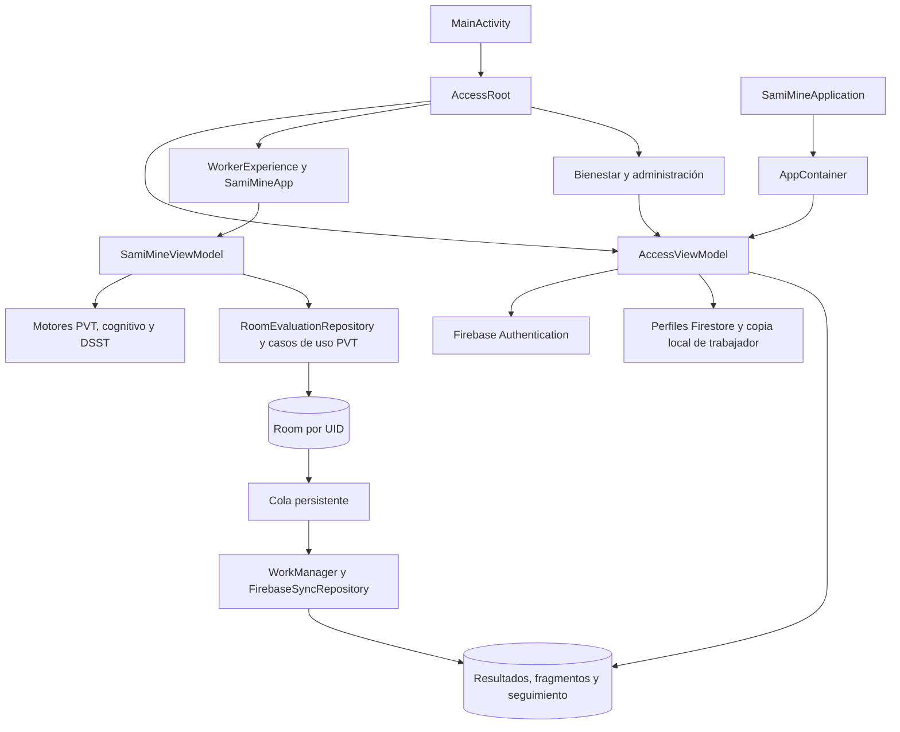

# Arquitectura actual de SamiMine

Revisión del código: **21/10/2026**. Esta guía describe la implementación del repositorio. Complementos: [guía del código](GUIA_DEL_CODIGO.md), [batería](BATERIA_IMPLEMENTACION.md), [piloto Firebase](FIREBASE_PILOTO.md) y [desarrollo](../README_DESARROLLO.md).

## Plataforma y alcance

SamiMine es una aplicación nativa Android para un piloto con datos ficticios. Implementa acceso por correo y contraseña, tres roles, seis tareas cognitivas independientes, historial local por cuenta y entrega de resultados a Firebase. El catálogo incluye KSS, Borg y Chalder, deshabilitados hasta disponer de contenido autorizado. El recorrido KSS → PVT depende de esa habilitación; no existe una batería clínica integrada de seis pruebas ni clasificación de aptitud.

| Elemento | Implementación |
|---|---|
| Proyecto | Un módulo Gradle `:app`; namespace/applicationId `dev.studios.samimine`; versión `1.0` (código 1) |
| Android | minSdk 26, compileSdk/targetSdk 37; no hay clientes iOS o web |
| Interfaz y estado | Kotlin, Compose, Material 3, una ComponentActivity, ViewModel, StateFlow y coroutines |
| Persistencia | Room 2.8.4, esquema 5 y migraciones no destructivas |
| Red | Firebase Authentication/Firestore, WorkManager 2.11.0 y permisos INTERNET/ACCESS_NETWORK_STATE |
| Herramientas | AGP 9.4.1, plugin Compose Kotlin 2.2.10, KSP 2.3.9; daemon JVM 25 y bytecode Java 11 |
| Firebase | Google Services 4.5.0, BoM 34.19.0; configuración Android local excluida de Git |

La compatibilidad declarada no demuestra validación física en todos los dispositivos. Las versiones se mantienen en el catálogo Gradle.

## Componentes, acceso y navegación

Las capas son paquetes dentro de un módulo, sin barreras de compilación. El dominio mantiene modelos, motores, puntuación y contratos independientes de Android/Room. AppContainer compone dependencias manualmente. Los casos de uso median PVT; el ViewModel usa directamente los contratos cognitivo y de batería para los demás recorridos.

La APK normal entra por AccessRoot. Firebase Auth conserva la sesión y el perfil activo de `users/{uid}` autoriza el acceso. No hay registro público. Un trabajador previamente verificado puede volver a entrar sin red usando su perfil local, únicamente si coincide el UID y sigue marcado activo en esa copia. La copia no tiene vencimiento propio; una revocación offline solo se detecta al recuperar conexión.

| Rol | Acceso implementado |
|---|---|
| WORKER | Pruebas, historial privado de su cuenta y cola de envíos |
| WELLBEING | Consulta online de trabajadores activos asignados, resultados completos y respuestas |
| ADMIN | Gestión de perfiles de trabajadores, activación y asignación; consulta de seguimiento sin resultados ni respuestas |

Los roles y cuentas Auth no se crean desde la app. Las reglas Firestore aplican propiedad, organización, asignación y permisos. Bienestar y administración requieren servidor; Firestore usa caché en memoria y las consultas explícitas usan `Source.SERVER`.

WorkerExperience crea un repositorio y ViewModel con la base del UID. SamiMineApp fija el trabajador autenticado, solicita turno y ofrece Inicio, Pruebas, Cuestionarios e Historial. La navegación interna usa enums y BackHandler, sin NavHost. DemoWorkers queda para la composición local del runner instrumentado; no es el ingreso de la APK normal.

## Ejecución, métricas y ciclo de vida

| Prueba | Protocolo | Práctica / ejecución |
|---|---|---|
| PVT | `demo-pvt-v1` | Sin práctica separada; 3 intentos; espera aleatoria 2–5 s y respuesta 3 s |
| Flanker | `demo-flanker-v2` | 2 ejemplos y 12 ensayos equilibrados; respuesta 3 s |
| GO/NO-GO | `demo-gonogo-v2` | 2 ejemplos y 20 ensayos, 16 GO/4 NO-GO; respuesta 3 s |
| Búsqueda Visual | `demo-visual-search-v1` | 1 ejemplo y 8 tableros 4×4; respuesta 4 s |
| DSST | `experimental-dsst-v1` | 6 ejemplos; asociación de seis símbolos/dígitos; plazo global 60 s |
| 1-back | `experimental-1back-v1` | 6 comparaciones de práctica y 24 puntuables; ventana 2.500 ms y estímulo 500 ms |

Las configuraciones y semillas permiten reproducir las tareas cognitivas; las versiones históricas conservan sus parámetros. Las prácticas no puntúan. Las métricas nuevas usan `descriptive-v2`; las anteriores mantienen `legacy-v1`. Los snapshots cognitivos guardan valor, unidad, denominador y método en `metric_results`; PVT mantiene sus métricas en la evaluación. Las sesiones incompletas o inválidas no reciben métricas finales. Véase el detalle en la [guía de batería](BATERIA_IMPLEMENTACION.md).

PVT usa elapsedRealtimeNanos; los ensayos cognitivos usan uptime en milisegundos para dibujo y contacto; las fechas usan epoch. Estas bases no deben mezclarse. La UI avisa del primer dibujo, sin asegurar el instante físico de emisión de píxeles. ContactGate y firstContactInput limitan gestos mantenidos/multitáctiles, y los callbacks incluyen sesión e índice para rechazar respuestas tardías. DSST mantiene un plazo único que no se reinicia por guardados o reintentos. 1-back mantiene la cadencia aunque el usuario responda antes.

El ViewModel serializa escrituras, conserva la operación para reintentar y relee antes de mostrar un resultado confirmado. El reintento en memoria no sobrevive a la muerte del proceso. Al recuperar almacenamiento se cierran registros que quedaron en curso; no se reanudan mediciones. Segundo plano, pérdida de foco o recreación interrumpen o invalidan mediciones según el recorrido. El estado de navegación y los temporizadores no tienen restauración persistente mediante SavedStateHandle.

## Persistencia y sincronización

La experiencia autenticada usa `samimine-user-{SHA-256(uid)}.db` en almacenamiento privado. El contenedor conserva además `samimine-demo.db` para la composición local de regresión, sin importar ese historial al usuario autenticado. Cerrar sesión borra la copia de perfil, libera la experiencia del trabajador y cancela sus trabajos; conserva sus datos y pendientes privados para el próximo ingreso de esa cuenta.

| Tablas | Contenido |
|---|---|
| `evaluations`, `attempts` | Contexto y configuración PVT, intentos, estado y métricas |
| `cognitive_sessions`, `cognitive_trials` | Prueba/versiones/semilla, ensayos, respuestas y tiempos |
| `assessment_sessions`, `self_reports` | Recorrido breve y respuestas de instrumentos habilitados |
| `metric_results` | Snapshots versionados de métricas cognitivas y PVT |
| `sync_queue` | Tipo e ID de ejecución, propietario, estado, intentos y error de entrega |

Las migraciones 1→2 agregan cognitivas; 2→3, intervalo entre ensayos; 3→4, batería, autorreportes, métricas y tiempos; 4→5, cola y entradas para registros cerrados. Se exportan esquemas 1–5 bajo el paquete actual. No se habilita migración destructiva. Los DAO usan transacciones para relaciones y el repositorio valida orden, propiedad, datos idénticos al reintentar y cierres completos.

El campo histórico PVT SyncStatus conserva únicamente NOT_ENABLED por compatibilidad; no representa la entrega actual. La fuente de estado de envío es sync_queue y su presentación en la experiencia autenticada.

Los cierres y el alta de pendientes comparten transacción Room. Los estados de cola son PENDING, SENDING, SYNCED y ATTENTION. WorkManager exige red, usa trabajo único por UID y backoff exponencial. Antes de enviar verifica cuenta y perfil. Los fallos temporales permiten reintento; denegaciones o conflictos quedan para revisión, sin borrar los registros.

Firestore organiza `users/{uid}/results/{kind_id}` con resumen y marca complete, subcolección chunks para ensayos/respuestas, y `tracking/{kind_id}` con datos operativos sin respuestas. Se reutilizan IDs y contenido en reintentos; los fragmentos son inmutables. La confirmación final y el seguimiento se escriben en una transacción remota. Solo una lectura posterior del servidor permite marcar SYNCED en Room. Bienestar consulta resultados completos; ADMIN solo seguimiento. No se recalculan métricas en servidor.

## Límites y verificación

El manifiesto deshabilita backup y las reglas de extracción excluyen datos locales. Room no tiene cifrado propio. No hay restauración del historial desde servidor, dashboard web, configuración remota de protocolos, clasificación de aptitud ni alertas clínicas. Los datos enviados son autodeclarados por el cliente; las reglas no demuestran que la prueba se haya ejecutado físicamente.

Las pruebas cubren motores, métricas, ViewModel, persistencia, migraciones, gestos, navegación y reglas de acceso. El runner separa regresión local de medición y aceptación contra emuladores Firebase. Los comandos y requisitos están en [desarrollo](../README_DESARROLLO.md); la aceptación autenticada se explica en [piloto Firebase](FIREBASE_PILOTO.md). Los resultados de esta revisión se registran en la guía de desarrollo. La temporización y accesibilidad en teléfonos físicos siguen pendientes de validación.
